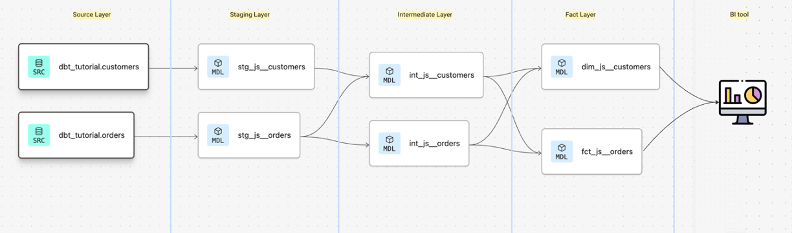

# dbt model structure
This directory contains dbt models, which are SQL files that define transformations on your data. Each model corresponds to a table or view in your data warehouse. The structure of the models can be organized into subdirectories for better organization and maintainability.

## The overall structure of dbt models can be visualized as follows:



## Example structure
```dbt_project/
├── models/
│   ├── staging/
│   │   ├── stg_customers.sql
│   │   └── stg_orders.sql
│   ├── marts/
│   │   ├── customers.sql
│   │   └── orders.sql
│   └── intermediate/
│       ├── int_customers.sql
│       └── int_orders.sql
```
In this example, we have a `models` directory with three subdirectories: `staging`, `marts`, and `intermediate`. The `staging` directory contains models that perform initial transformations on raw data, the `marts` directory contains models that create final tables for analysis, and the `intermediate` directory contains models that perform intermediate transformations.

